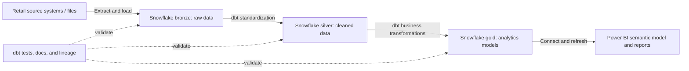

# Retail Store Analytics: dbt, Snowflake & Power BI

This project uses an ELT workflow to load retail data into Snowflake, transform it with dbt, and publish analytics-ready models for Power BI. The data domain includes stores, customers, products, sales, and product returns.

## System architecture

**Flow:** Source data is loaded to Snowflake before transformation (ELT). dbt manages transformations and dependencies within the warehouse. Business analysts use the curated gold layer through Power BI.

## Objectives

- Consolidate retail data in a cloud data warehouse.
- Preserve source-shaped data while creating traceable, repeatable transformations.
- Standardize data quality and business definitions across reporting.
- Deliver documented, tested models that support business analysis.

## Medallion layers

| Layer | Purpose | Example contents |
| --- | --- | --- |
| **Bronze** | Retain data as loaded, with minimal modification. | Raw store, customer, product, sales, and return records; ingestion metadata where available. |
| **Silver** | Clean and conform data for reliable reuse. | Standardized names and types, deduplication, consistent identifiers, and validated relationships. |
| **Gold** | Present curated data for analytics. | Sales and returns facts, store/product/customer dimensions, and reporting aggregates with agreed metric definitions. |

Power BI should use approved gold models so core business logic is not duplicated across reports. The exact model grain, measures, and relationships should be agreed with business stakeholders.

## Technologies

- **Snowflake** — cloud data warehouse and execution platform.
- **dbt** — SQL transformations, model dependencies, tests, and documentation.
- **Power BI** — semantic modeling, dashboards, and reports.
- **ELT ingestion** — extracts data from source systems and loads it into Snowflake. The ingestion product and source platforms are environment-specific.
- **Git (recommended)** — version control and review of project changes.

## Business rationale

Retail data can be distributed across operational systems and use inconsistent formats or definitions. A layered warehouse preserves loaded inputs, centralizes cleansing and business rules, and gives analysts a consistent foundation for questions such as sales by store or product, customer trends, and return rates. This improves traceability, reduces repeated report logic, and makes changes easier to validate.

## Data flow and development lifecycle

1. Extract source data and load it into Snowflake bronze tables.
2. Declare the loaded tables as dbt sources and configure the project connection.
3. Build silver models to standardize fields, address duplicates and nulls, and test important keys and relationships.
4. Build gold facts, dimensions, and aggregates using documented business rules.
5. Run dbt tests and review model documentation and lineage before publishing.
6. Connect Power BI to the gold layer, configure its semantic model and refresh, and share reports with business users.

Typical dbt commands, run from the dbt project directory:

## Dependencies and prerequisites

- Access to the retail source data and a functioning extraction/loading process.
- Snowflake account, database, schemas, warehouse, roles, and permissions for ingestion, dbt, and Power BI.
- A compatible dbt installation with the Snowflake adapter and a securely configured connection.
- A dbt project with source declarations, model configuration, and environment-specific targets.
- Power BI access and a supported Snowflake connection, with dataset ownership and refresh credentials configured.
- Stakeholder-approved definitions for metrics such as net sales and return rate, including treatment of discounts, taxes, cancellations, and returned items where applicable.

Exact versions, source systems, schemas, credentials, model names, and ingestion tooling depend on the deployment. Keep secrets in secure environment-managed configuration, not in source control.

## Quality, security, and operations

- Add suitable `not_null`, `unique`, relationship, and accepted-value tests to critical models.
- Reconcile row counts and key totals against source extracts where possible.
- Monitor ingestion freshness, dbt job results, warehouse consumption, and Power BI refresh status.
- Define how late-arriving data, corrections, deletes, and incremental rebuilds are handled.
- Apply role-based access and limit sensitive customer data to what reporting requires.
- Document model owners, refresh cadence, metric definitions, and known limitations.
- Data Lineage
